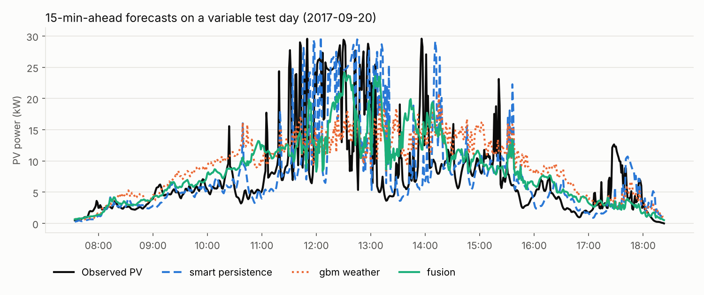

# pvcast — Multimodal Short-Term PV Power Forecasting

Forecast the output of a photovoltaic (PV) plant **15 minutes ahead** by fusing three sources of information:

| Modality | Source | What it captures |
|---|---|---|
| **Sky images** | 64×64 all-sky camera frames at t−15, t−10, t−5, t (+ last-frame difference) | cloud position and motion |
| **PV history** | power and clear-sky index at the same lags | current state and recent variability |
| **Weather** | Open-Meteo hourly reanalysis (cloud cover by layer, irradiance, temperature, humidity, wind) | regime: clear, broken, overcast |

plus deterministic solar geometry and a clear-sky PV reference. Everything is reproducible on a laptop CPU with public data.



## Results

Held-out test set of the [SKIPP'D](https://huggingface.co/datasets/torchgeo/skippd) benchmark (Stanford, 30.1 kW array). Skill is relative to **smart persistence** (clouds persist, the sun moves), the standard reference in solar forecasting — positive skill means better than the reference.

<!-- RESULTS -->

## How it works

```
 sky images ──► CNN encoder ──┐
 (t-15…t, + Δ)                │
                              ├─► fusion head ─► clear-sky index k̂(t+15) ─► × PV_clearsky(t+15) ─► PV(t+15)
 PV history, k*, weather, ──► MLP ──┘
 solar geometry
```

* **Clear-sky normalisation.** Models predict the *clear-sky index* k* = PV / PV_clearsky, so they learn cloud effects rather than the daily cycle. The clear-sky PV reference is fitted to the upper envelope of observed PV against pvlib's Ineichen clear-sky irradiance (the array orientation is not part of the dataset).
* **No look-ahead leakage.** Weather comes from hourly *reanalysis*; the code uses the last *completed* hour only (never interpolates toward the future). Train/validation splits are by **day**, and the test days are the official SKIPP'D test set. Both properties are unit-tested.
* **Robust to a missing camera.** The fusion net is trained with *modality dropout* (the image branch is randomly blanked), so it still forecasts when the camera is offline — reported as `fusion (camera offline)`.
* **Safe data loading.** SKIPP'D timestamps are pickled object arrays; they are read with a restricted unpickler that only allows `datetime` and numpy types (a test proves a malicious pickle is blocked).
* **Small downloads.** The source HDF5 is 4.5 GB; `01_download.py` reads it remotely with HTTP range requests and fetches only the chosen days (~600 MB by default).

## Models

| Name | Inputs | Method |
|---|---|---|
| `persistence` | PV(t) | PV(t+15) = PV(t) |
| `smart_persistence` | k*(t), clear-sky | PV(t+15) = k*(t) · PV_cs(t+15) — **reference** |
| `gbm_history` | PV history + geometry | gradient-boosted trees on k* |
| `gbm_weather` | + weather | gradient-boosted trees on k* |
| `cnn_image` | sky images + PV history | CNN (SUNSET-style) |
| `fusion` | images + history + weather + geometry | CNN + MLP fusion |

## Quick start

```bash
pip install -r requirements.txt
python scripts/run_all.py                      # download subset → train → evaluate (CPU, ~40 min)
python -m pytest -q tests
```

Step by step:

```bash
python scripts/01_download.py --train-days 80  # 0 = all 2017-2019 training days
python scripts/02_train.py --epochs 8
python scripts/03_evaluate.py                  # writes reports/results.md and figures
```

Use the trained models directly:

```python
from pvcast.models.gbm import GBMForecaster
from pvcast.models.nets import NetForecaster
gbm = GBMForecaster.load("models/gbm_weather.joblib")
fusion = NetForecaster.load("models/fusion.pt")
```

## Repository layout

```
pvcast/
  data/skippd.py     remote subset download, safe timestamp loading
  data/weather.py    Open-Meteo archive client, leakage-safe alignment
  solar.py           solar geometry, clear-sky irradiance, clear-sky PV fit
  features.py        sample construction (lags, horizon, day split)
  models/            baselines, gradient boosting, CNN / fusion network
  evaluation.py      RMSE, MAE, MBE, nRMSE, forecast skill
scripts/             01_download, 02_train, 03_evaluate, run_all
models/              trained models (from the default run)
reports/             results tables and figures
tests/               unit tests
```

## Limitations

* Default training uses 80 of 497 available training days to stay CPU-friendly; training on all days (`--train-days 0`, GPU) should improve the deep models.
* Weather is reanalysis, which is *better* than a real-time NWP forecast would be; for operational use, swap in forecasts issued before the forecast time.
* Single site, one horizon (15 min). The horizon is a parameter (`--horizon` in `02_train.py`).

## Data and citation

* **SKIPP'D** — Nie Y., Li X., Scott A., Sun Y., Venugopal V., Brandt A. *SKIPP'D: A SKy Images and Photovoltaic Power Generation Dataset for short-term solar forecasting.* Solar Energy 255 (2023) 171–179. CC BY 4.0.
* **Weather data by [Open-Meteo.com](https://open-meteo.com)** — CC BY 4.0.

Raw data is not redistributed; the scripts download it from the original sources.

## License

Code: [Apache License 2.0](LICENSE). See [NOTICE](NOTICE) for third-party data attributions.
